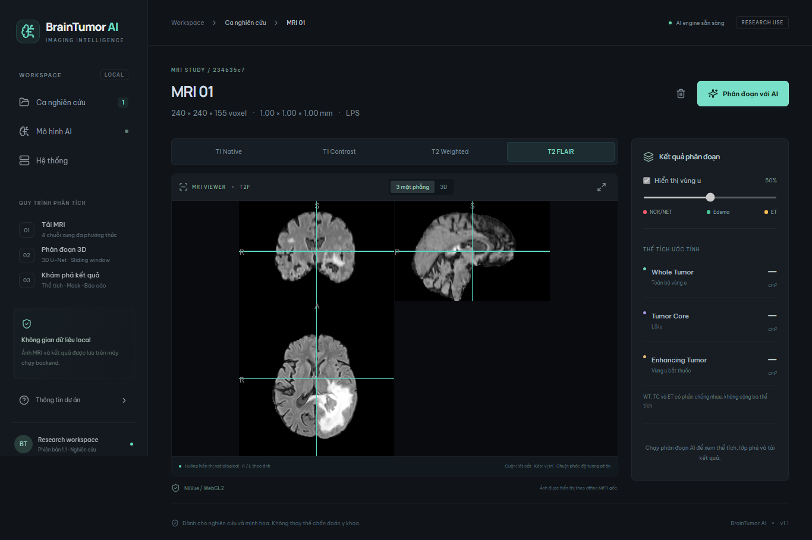

# BrainTumor AI

[](https://github.com/quoctu003/brain-tumor-segmentation/actions/workflows/ci.yml)

Ứng dụng nghiên cứu phân đoạn u não trên MRI đa chuỗi xung: tải bốn ảnh NIfTI, xem MRI ba mặt phẳng/3D, chạy 3D U-Net và xuất mask, PDF, JSON hoặc ZIP kết quả.

**React 19 · TypeScript · Vite · Tailwind CSS · NiiVue · FastAPI · PyTorch · MONAI · SQLite / PostgreSQL**



## Dataset và checkpoint đã train

**[Google Drive: dataset và checkpoint của dự án](https://drive.google.com/drive/folders/1DiVBV9V008vfxkIfmepf5g5WlCrqBVpV?usp=drive_link)**

Dữ liệu và trọng số không nằm trong Git để giữ repository nhẹ. Tải phần cần dùng từ Drive và giải nén trước khi import; không cần tải toàn bộ dataset chỉ để mở ứng dụng. Nếu Drive yêu cầu đăng nhập hoặc báo thiếu quyền, cần dùng tài khoản được chủ thư mục cấp quyền. Liên kết do tác giả cung cấp; nội dung và quyền tải công khai chưa được xác minh trong lần rà soát này.

- **Chạy AI:** cần inference bundle gồm `model_metadata.json` và `unet_v1_demo.pth` (tên export cũ) hoặc `unet_v2_best.pth`. `evaluation.json` là tùy chọn.
- **Thử một ca:** cần đủ `t1n`, `t1c`, `t2w`, `t2f` của cùng ca, dạng `.nii` hoặc `.nii.gz`.
- **Train lại:** xem [notebook và hướng dẫn](notebooks/README.md). Checkpoint resume/best/last phục vụ train không mặc nhiên thay thế được inference bundle.

Xem [hướng dẫn dataset/checkpoint](docs/DATA-AND-MODELS.md) để biết cấu trúc file, checksum và cách khắc phục lỗi.

## Chạy nhanh trên máy mới

Yêu cầu **Python 3.12 hoặc 3.13**, **Node.js 22.12+ hoặc 24 LTS**, trình duyệt hỗ trợ WebGL2 và Internet cho lần cài đầu. Khuyến nghị Python 3.12 + Node.js 24. CPU chạy được; không bắt buộc có GPU hay Docker. Đặt dự án trên ổ local, tránh thư mục đồng bộ Drive/OneDrive.

```bash
git clone https://github.com/quoctu003/brain-tumor-segmentation.git
cd brain-tumor-segmentation
```

Hoặc chọn **Code → Download ZIP** trên GitHub rồi giải nén.

**Windows:** mở `START_BRAINTUMOR.cmd`. **macOS / Linux:** chạy:

```bash
python3 scripts/launch.py
```

Launcher tạo `.venv` riêng, cài dependency với PyTorch CPU, chạy `npm ci`, build giao diện rồi mở **http://127.0.0.1:8080**. Lần đầu có thể mất vài phút và cần tải các gói lớn. Giữ terminal đang chạy; nhấn **Ctrl+C** để dừng. Giao diện vẫn mở được khi chưa có model; chức năng AI sẵn sàng sau bước import bên dưới.

### Import model

Tải inference bundle từ Drive, giải nén, rồi chạy tại gốc dự án:

```bash
python scripts/prepare_model.py --bundle "DUONG_DAN_DEN_THU_MUC_BUNDLE"
```

Script chỉ dùng thư viện chuẩn Python, kiểm SHA-256 trước/sau khi chép và giữ nguyên nguồn. Trên macOS/Linux, dùng `python3` nếu máy không có lệnh `python`. Thư mục truyền vào phải chứa trực tiếp metadata và weights. Sau đó **dừng và mở lại ứng dụng** để nạp model.

```text
models/
  unet_v2_best.pth
  model_metadata.json
  evaluation.json          # tùy chọn
```

### Phân tích MRI

1. Bấm **Thêm ca MRI**, nhập tên ca ẩn danh.
2. Chọn T1 Native (`t1n`), T1 Contrast (`t1c`), T2 Weighted (`t2w`), T2 FLAIR (`t2f`).
3. Mở ca và bấm **Phân đoạn với AI**.
4. Xem ba mặt phẳng/3D, đổi chuỗi xung, điều chỉnh lớp phủ và tải kết quả.

Ảnh phải cùng shape/affine và đã tiền xử lý, căn chỉnh theo protocol BraTS. Ứng dụng không thực hiện registration, skull stripping, crop hay resample. Shape/affine khớp không xác nhận được người dùng đã chọn đúng bệnh nhân/chuỗi xung. [Hướng dẫn chọn file](docs/07-THEM-CA-MRI.md).

## Model và kết quả huấn luyện

| Thuộc tính | Giá trị |
|---|---|
| Thí nghiệm | `unet_v2_resumable_001`, 50 epoch |
| Model sử dụng | MONAI 3D U-Net; 4 kênh vào, 4 lớp ra; best epoch 45 |
| Nhãn | 0: nền; 1: NCR/NET; 2: phù nề; 3: u tăng quang |
| Validation | 183 ca; Dice mean **0.875809** |
| Held-out test | 194 ca; Dice mean **0.893744** |
| Test WT / TC / ET | **0.920528 / 0.908923 / 0.851781** |
| SHA-256 weights | `dbba1a212c9c8e0443d3c7fd763e22f9eb3ec80ce7fb4451c231ff0bebe0892f` |

Metric lấy từ metadata/evaluation của lần train, **không phải đánh giá lại toàn bộ test set trong lần rà soát phần mềm**. Smoke test với checkpoint thật xác minh load/forward/export, không đo độ chính xác. WT/TC/ET là các vùng chồng lấp, không cộng thể tích ba vùng. Ứng dụng không báo Dice cho ca tải lên khi không có ground truth.

## Phát triển và kiểm thử

Launcher dùng `.venv` và phiên bản dependency trực tiếp đã chốt trong `backend/requirements.txt`; dependency bắc cầu chưa có lockfile đa nền tảng. Frontend dùng `npm ci` và lockfile. Để chạy backend/frontend riêng:

```bash
python -m venv .venv
```

Kích hoạt môi trường: Windows PowerShell dùng `.\.venv\Scripts\Activate.ps1`; macOS/Linux dùng `source .venv/bin/activate`. Sau đó:

```bash
python -m pip install torch==2.13.0 --index-url https://download.pytorch.org/whl/cpu
python -m pip install -r backend/requirements-dev.txt
python -m uvicorn app.main:app --app-dir backend --host 127.0.0.1 --port 8000
```

Trong terminal khác:

```bash
cd frontend
npm ci
npm run dev
```

Mở **http://127.0.0.1:5173**; API docs tại **http://127.0.0.1:8000/docs**. Tùy chỉnh bằng cách sao chép `backend/.env.example` thành `backend/.env`; đường dẫn tương đối tính từ gốc dự án. Nếu dùng CUDA, cài bản PyTorch 2.13.0 phù hợp GPU vào `.venv` trước khi chạy launcher, theo [hướng dẫn PyTorch](https://pytorch.org/get-started/locally/).

```bash
python -m pytest backend/tests -q
python scripts/smoke_model.py       # cần import model thật
cd frontend
npm test
npm run build
npm run format:check
```

Windows có thể dùng `powershell -ExecutionPolicy Bypass -File scripts/test.ps1` để tạo thư mục test riêng. Browser tests: [hướng dẫn kiểm thử](docs/TESTING.md). CI dùng dữ liệu tổng hợp, không cần Drive hay checkpoint riêng.

## Docker và PostgreSQL

Cần Docker Compose v2. Import model trước, sau đó đặt `POSTGRES_PASSWORD` (chữ/số/dấu gạch) trong môi trường hoặc `.env` tại gốc dự án và chạy:

```bash
docker compose up --build
```

Mở **http://127.0.0.1:8080**. Backend dùng CPU; PostgreSQL 17 và file ca được lưu trong named volumes. `docker compose down` dừng dịch vụ và giữ dữ liệu. Cài backend PostgreSQL ngoài Docker bằng `python -m pip install -r backend/requirements-postgres.txt`.

Docker/PostgreSQL và CUDA chưa được chạy kiểm chứng trong môi trường rà soát này.

## Cấu trúc và tài liệu

| Thư mục | Vai trò |
|---|---|
| `backend/` | API, kiểm tra MRI, inference, database, PDF và kiểm thử |
| `frontend/` | Giao diện React/TypeScript, MRI viewer, kiểm thử trình duyệt |
| `scripts/` | Launcher, import model, smoke test, đóng gói |
| `models/` | Model cục bộ, chỉ README được Git theo dõi |
| `notebooks/` | Notebook train đã bỏ output |
| `docs/` | Kiến trúc, hướng dẫn, bằng chứng kiểm thử |

[Kiến trúc/API](docs/02-KIEN-TRUC-VA-API.md) · [Vận hành](docs/05-DEMO-VA-VAN-HANH.md) · [Rà soát mới nhất](docs/REVIEW-2026-11-14.md) · [Changelog](CHANGELOG.md)

Launcher lưu ca/DB/log tại `%LOCALAPPDATA%/BrainTumorAI` trên Windows hoặc `~/.local/share/BrainTumorAI` trên macOS/Linux; không xóa thư mục này để dọn mã nguồn. Chạy API thủ công mặc định dùng `storage/` trong dự án. Dataset, checkpoint, môi trường, database và file build/cache đều được loại khỏi Git.

Ứng dụng dành cho nghiên cứu local một người dùng, chưa có đăng nhập/phân quyền. Chạy một process API với một worker inference; không thêm nhiều Uvicorn workers. Kết quả không thay thế chẩn đoán y khoa và chưa được xác nhận trên MRI bệnh viện ngoài BraTS.
