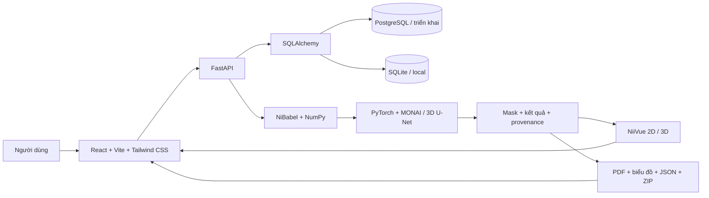

# Kiến trúc công nghệ

| Thành phần | Công nghệ | Áp dụng trong dự án |
|---|---|---|
| Frontend | React + Vite + Tailwind CSS | TypeScript, utility CSS có prefix `tw:`, giao diện responsive và các component workspace |
| Backend | Python + FastAPI | API upload, ca nghiên cứu, hàng đợi, demo, artifact và trạng thái hệ thống |
| AI | PyTorch + MONAI, 3D U-Net | Checkpoint thật, sliding-window inference 3D, TTA theo protocol export |
| Database | PostgreSQL + SQLAlchemy | Docker triển khai PostgreSQL; SQLAlchemy giữ hợp đồng truy cập dữ liệu |
| MRI Viewer | NiiVue | Đọc NIfTI, ba mặt phẳng và chế độ 3D bằng WebGL2 |
| Xử lý MRI | NiBabel + NumPy | Kiểm tra hình học, dữ liệu tín hiệu, tiền xử lý và xuất mask; SciPy lọc thành phần nhỏ |
| Báo cáo | PDF + biểu đồ | ReportLab tạo bảng và biểu đồ vector; giao diện có biểu đồ SVG từ cùng kết quả thể tích |
| Môi trường | VS Code, Python, Node.js | File CMD một bước, launcher Python, script phát triển, test và production build |

**Chế độ local:** `START_BRAINTUMOR.cmd` dùng SQLite + SQLAlchemy để không yêu cầu cài một database server. File `DEMO_BRAINTUMOR.cmd` là tên khởi động tương thích cũ, cũng mở trang chủ. Người dùng tự tải từng ca MRI lên.

**Chế độ PostgreSQL:** `START_POSTGRES_DEMO.cmd` chạy Docker Compose gồm PostgreSQL, FastAPI và nginx/frontend. Cần Docker Desktop đang hoạt động. Script tạo mật khẩu ngẫu nhiên lần đầu và giữ cấu hình trong `%LOCALAPPDATA%/BrainTumorAI/docker.env`; không in mật khẩu ra màn hình. `scripts/stop-postgres.ps1` dừng container và giữ volume dữ liệu.

Các job xử lý tuần tự bằng một worker trong một process API. Khóa storage ngăn hai process cùng sở hữu dữ liệu. Đây chưa phải một queue phân tán hoặc nền tảng nhiều người dùng.

## Nguồn kết quả

Ca tải lên chạy checkpoint thật khi bấm **Phân đoạn với AI**, tạo job có `live_inference`. Các kết quả cũ có nguồn `recorded_inference` vẫn được nhận diện và giữ nguyên lịch sử. Backend còn API import bundle cũ để tương thích; giao diện không gọi API này và không tự nạp kết quả. PDF, JSON, ZIP thể hiện nguồn kết quả.

Biểu đồ biểu diễn thể tích WT/TC/ET, không biểu diễn xác suất chẩn đoán hoặc Dice của ca. Ba vùng có chồng nhau; không cộng thể tích. Chưa có ground truth thì không đánh giá Dice cho ca mới.

## Tailwind CSS

Tailwind được tích hợp qua `@tailwindcss/vite`. Theme và utilities dùng prefix `tw:`; các style chuyên biệt cho viewer được giữ trong CSS của workspace. Không đưa Preflight vào để tránh thay đổi các style nền đã có. Cách tích hợp từng lớp có trong [tài liệu Tailwind chính thức](https://tailwindcss.com/docs/preflight#disabling-preflight).
