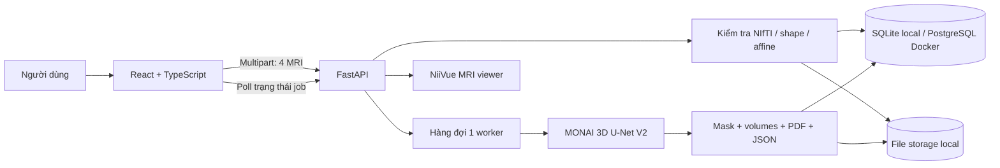

# Kiến trúc và hợp đồng API

## API

| Method | Endpoint | Chức năng |
|---|---|---|
| GET | `/api/health` | Kiểm tra API, DB và tình trạng model |
| GET | `/api/model` | Provenance model, SHA-256, epoch và số liệu test ghi nhận |
| GET | `/api/system` | Database, hàng đợi, dung lượng và phiên bản runtime |
| POST | `/api/cases` | Upload multipart: `name`, `t1n`, `t1c`, `t2w`, `t2f` |
| GET | `/api/cases?limit=50&offset=0` | Danh sách ca, tối đa100/lần, job gần nhất |
| GET | `/api/cases/{id}` | Geometry và trạng thái ca |
| GET | `/api/cases/{id}/volumes/{modality}` | NIfTI gốc trong bản sao upload |
| POST | `/api/cases/{id}/inference` | Tạo job202; ca đang chạy trả lại job hiện tại |
| GET | `/api/jobs/{id}` | Poll queued/running/completed/failed |
| GET | `/api/cases/{id}/jobs` | Tối đa 50 lần chạy gần nhất của một ca |
| GET | `/api/jobs/{id}/bundle` | ZIP chứa mask, PDF, JSON và README |
| GET | `/api/jobs/{id}/artifacts/mask` | Mask NIfTI nhãn0/1/2/3 |
| GET | `/api/jobs/{id}/artifacts/report` | PDF |
| GET | `/api/jobs/{id}/artifacts/json` | Thể tích, thời gian và model provenance |
| DELETE | `/api/cases/{id}` | Xoá bản sao ca và kết quả trong ứng dụng; chặn ca đang chạy |

OpenAPI thực được sinh tại `/docs` và `/openapi.json`.

API `/api/demo` vẫn được giữ để tương thích bundle cũ và kiểm thử, không được giao diện hiện tại gọi tự động.

## Hợp đồng MRI/model

- Input: 4 volume3D cùng shape/affine, hữu hạn, có vùng tín hiệu dương và phương sai đủ lớn.
- Đơn vị: mm. Unknown được hiểu là mm theo protocolBraTS và báo cho người dùng; không nhận meter/micron rồi coi làmm.
- Kênh: T1n → T1c → T2w → T2f. Không tự thay thứ tự.
- Chuẩn hoá: foreground intensity>0, clip percentile0.5/99.5 rồi Z-score trên foreground, nền giữ0.
- Mô hình: U-Net3D channels16/32/64/128/256, strides2/2/2/2, residual units2, instance norm, dropout0.2.
- Inference: patch96³, batch/overlap/TTA/component threshold đọc nguyên từ protocol, ghép xác suất float32 trên CPU.
- Output giữ affine gốc, uint8, nhãn0background/1NCR-NET/2ED/3ET. NhãnET3 theo BraTS2023, không tự đổi sang4.
- WT=(1|2|3), TC=(1|3), ET=3. cm³ = số voxel × |det(affine3x3)| /1000.

## Vòng đời job

`queued → running → completed`, hoặc `queued/running → failed`.

Chỉ đánh dấu completed sau khi mask, PDF và JSON ghi xong. Nếu API restart, job chưa xong thành failed để người dùng chủ động chạy lại. Model nạp một lần tại startup, file model được kiểm hash trước khi load. Torch sử dụng `weights_only=True`, load_state_dict strict.

Không chạy nhiều Uvicorn worker trên cùng hàng đợi hiện tại. Muốn triển khai nhiều người dùng cần tách worker thành queue durable như Redis/Celery, bổ sung phân quyền, migrations và chính sách lưu dữ liệu. Đây là hướng mở rộng, không phải tính năng đã có.

## Nguồn kỹ thuật

- FastAPI multipart upload: https://fastapi.tiangolo.com/tutorial/request-files/
- NiiVue loading/API: https://niivue.com/docs/loading/ và https://niivue.com/docs/api/niivue/classes/Niivue/
- MONAI sliding window: https://monai.readthedocs.io/en/stable/inferers.html

Phiên bản frontend được khoá bằng package-lock. Backend dùng constraints có giới hạn major; nếu cần tái lập môi trường nguồn GPU chính xác, lưu thêm lock theo nền tảng tương ứng sau khi cài CUDA/Torch.
