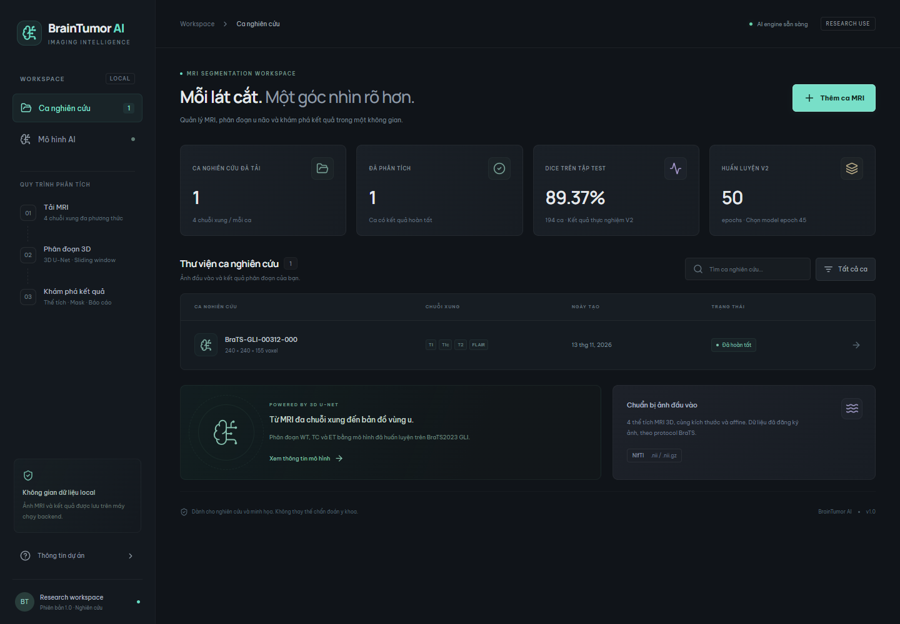
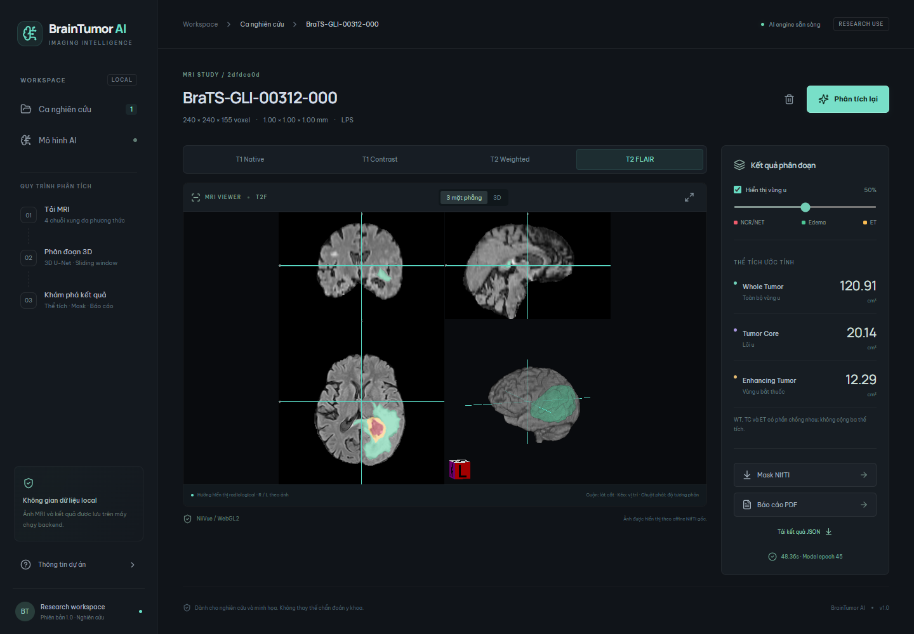
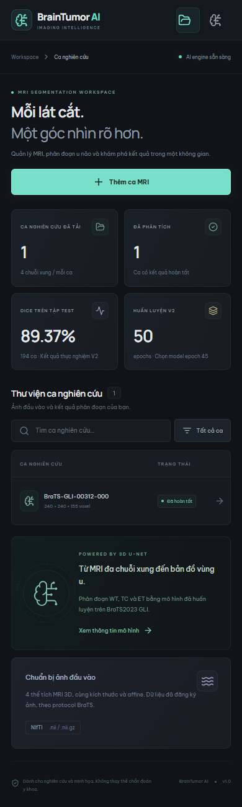

# Kết quả kiểm thử — 13/11/2026

Đây là ghi nhận của lần kiểm thử trước. Xem [đợt rà soát tiếp theo](04-RA-SOAT-VA-CAI-THIEN.md) để biết các thay đổi và kết quả mới nhất; các ca thật/ảnh chụp bên dưới chưa được chạy lại trong đợt đó.

## Đã xác nhận

| Hạng mục | Kết quả |
|---|---|
| Checkpoint cuối | Epoch50, complete=true, selected epoch45 |
| SHA-256 export | Trùng metadata và bản sao trong models/ |
| Load state dict | Strict load thành công với MONAI U-Net |
| Backend | **13 tests passed** |
| Smoke model thật | Input tổng hợp32³, patch96³, forward và NIfTI export đạt |
| Frontend | TypeScript strict và Vite production build đạt |
| API thực | Health200, database connected, model_ready=true |
| Upload qua giao diện | Ca thật BraTS-GLI-00312-000, bốn chuỗi xung, HTTP201 |
| Inference qua giao diện | Trọng số thật, hoàn tất trong48.36giây trên CPU |
| Viewer | Hiển thị MRI, mask label màu, đổi modality, bật/tắt overlay, chế độ3D |
| Download | Mask NIfTI, báo cáo PDF và result JSON đều HTTP200 |
| Browser | Microsoft Edge headless với WebGL2; không ghi nhận pageerror JavaScript |
| Mobile390px | Không tràn ngang ở thư viện và workspace MRI |

Ví dụ ca thật vừa chạy có thể tích WT **120.913 cm³**, TC **20.140 cm³**, ET **12.293 cm³**. Các giá trị này là dự đoán của model trên một ca, không phải số đo lâm sàng hoặc độ chính xác đã đánh giá.

Môi trường kiểm thử: Windows, Python3.13.6, Torch2.13.0+cpu, MONAI1.6.0, FastAPI0.141.1, SQLAlchemy2.0.43, Node24.16.0. Môi trường khác bản train nguồn; chưa đối chiếu lại toàn bộ test set để khẳng định tái lập bitwise. Ba cảnh báo deprecation từ TestClient/Torch không làm test thất bại.

## Ảnh chụp ứng dụng thật

## Phạm vi chưa xác nhận

- Docker/PostgreSQL đã có cấu hình nhưng máy không có Docker để chạy kiểm chứng.
- Chưa kiểm thử GPU CUDA, nhiều người dùng hoặc triển khai Internet.
- Chưa chạy lại toàn bộ194ca test; số liệu test trong model card là kết quả đã ghi nhận từ export gốc.

## Dữ liệu và vệ sinh thư mục

Một bản sao ca BraTS-GLI-00312-000 và các kết quả kiểm thử qua UI được giữ trong `%LOCALAPPDATA%/BrainTumorAI/storage`, tách khỏi dataset gốc. Có thể xóa ca này ngay trong ứng dụng. Notebook, dataset và runs_v2 gốc được giữ nguyên.

Google Drive đã làm hỏng lần cài frontend đầu tiên. Dependencies và build sau đó được thực hiện thành công ở ổ local. `frontend/dist/` là bản build sẵn; để phát triển, chép dự án sang SSD local rồi dùng `npm ci`.

Lệnh dọn `frontend/node_modules/` bị cơ chế kiểm duyệt tự động chặn. Thư mục sinh ra từ lần cài lỗi được giữ nguyên, đã nằm trong .gitignore và không cần đưa vào Git hoặc bản bàn giao mã nguồn.
