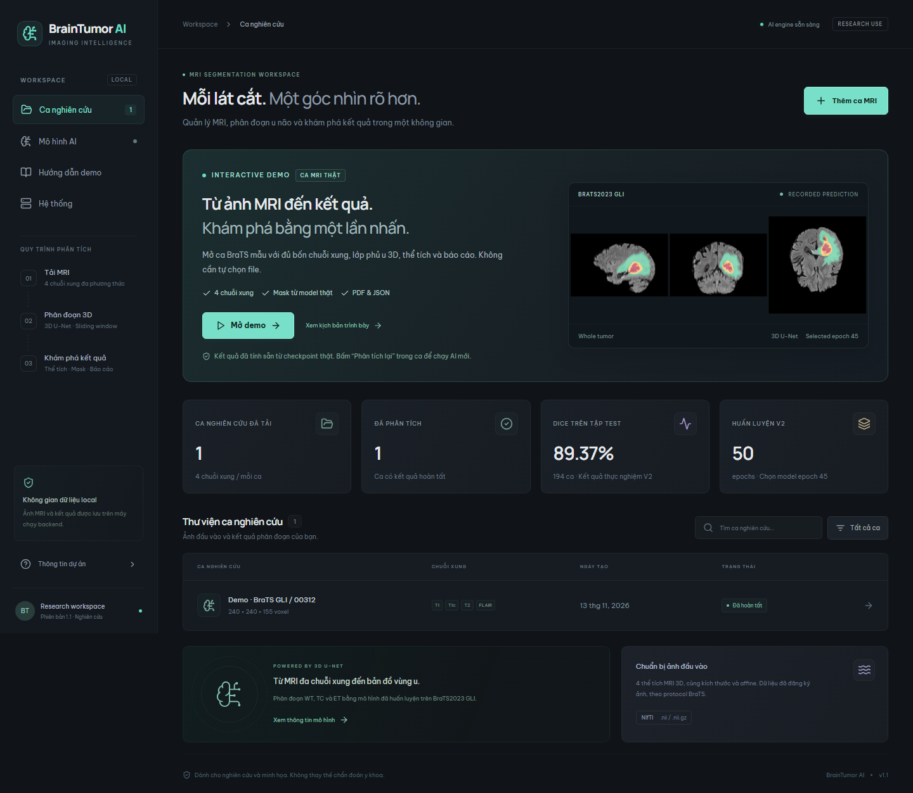
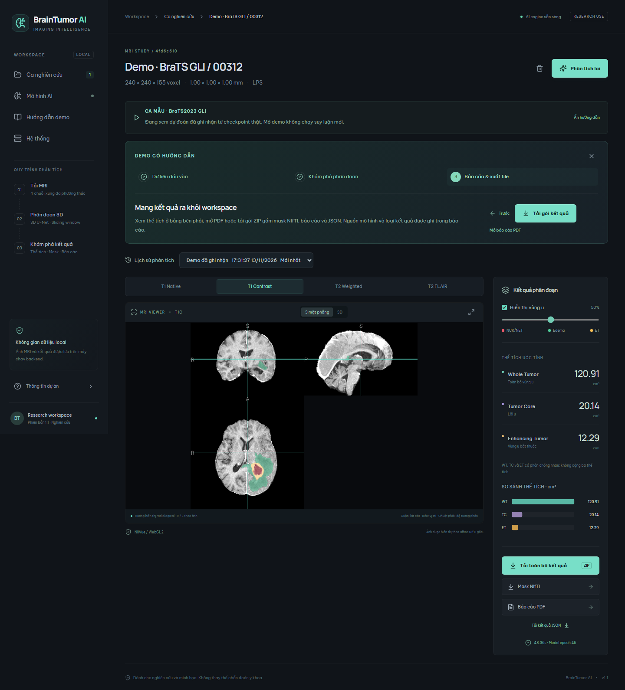
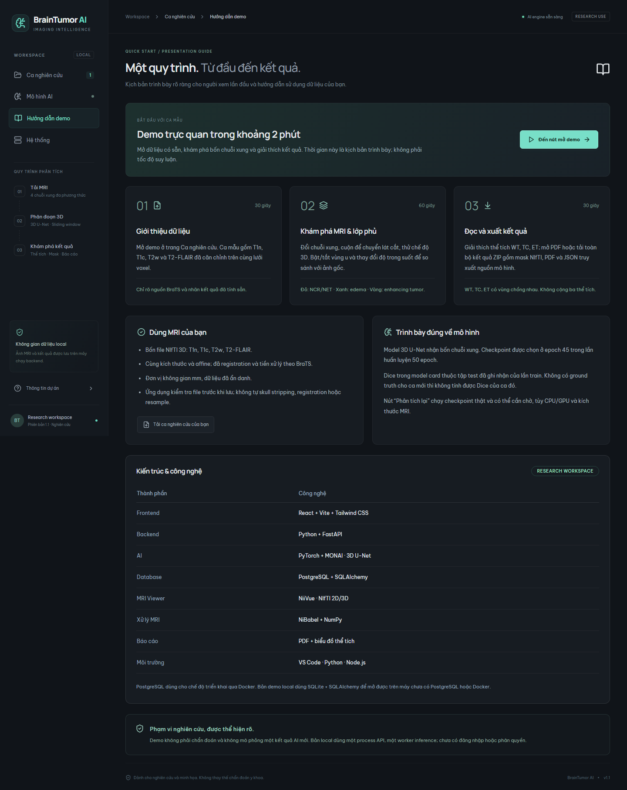
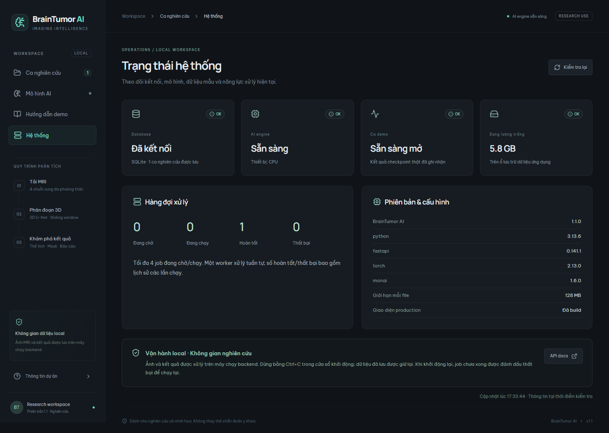
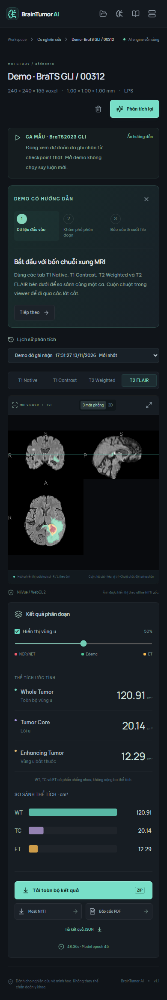
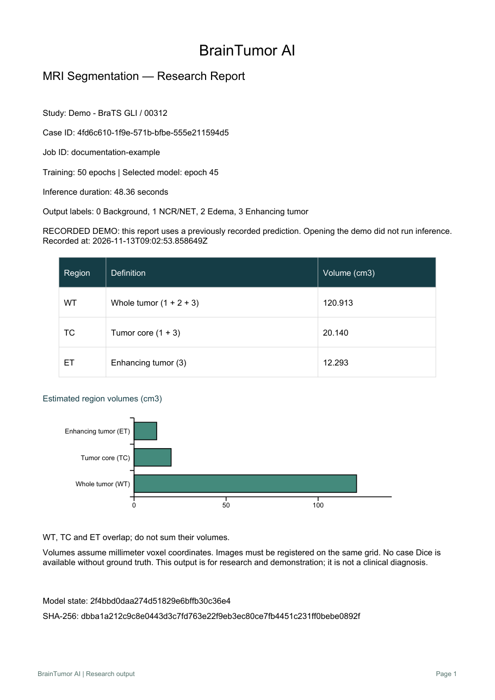

# Kiểm thử và bàn giao 1.1 — 13/11/2026

> Tài liệu lịch sử của bản bàn giao ban đầu. Giao diện hiện tại đã bỏ nút và hướng dẫn demo, không tự import ca. Cả hai file CMD local đều mở trang chủ để tự tải MRI. Xem [hướng dẫn hiện tại](07-THEM-CA-MRI.md), [vận hành](05-DEMO-VA-VAN-HANH.md) và [rà soát mới nhất](08-KIEM-TRA-TOAN-DU-AN.md).

## Kết quả đã chạy

| Kiểm tra | Kết quả |
|---|---|
| Backend pytest | **31 passed** |
| Frontend Vitest | **13 passed** |
| Playwright / Edge headless | **3 passed** |
| TypeScript + Vite production | Build thành công, có Tailwind utilities |
| PDF mẫu | Một trang, có bảng, biểu đồ vector, provenance demo và footer; đã render để kiểm tra |
| Launcher local | Đã kiểm tra khởi động, health, giao diện, demo metadata và shutdown với database thử riêng |
| Dependency runtime frontend | `npm audit --omit=dev --audit-level=high`: 0 vulnerabilities tại thời điểm chạy |

Ba kịch bản trình duyệt bao gồm:

1. Mở URL demo trực tiếp, tự import ca, xem MRI và quay về trang chủ.
2. Mở demo bằng nút trên trang chủ, đổi modality, bật/tắt overlay, đổi 3D/ba mặt phẳng, đi qua hướng dẫn và tải ZIP.
3. Mở hướng dẫn và trạng thái hệ thống; kiểm tra thư viện và viewer ở chiều rộng 390px, không tràn ngang.

Browser tests dùng API thật, checkpoint được nạp thật và bản dự đoán đã ghi nhận trong bundle. Không chạy lại toàn bộ inference ca BraTS trong mỗi bài test. Trình duyệt dùng SwiftShader cho WebGL phần mềm nên cả suite có thể mất vài phút; đây không phải thời gian suy luận của mô hình.

Backend tests kiểm tra demo khi model không sẵn sàng, checksum bị hỏng, import lặp, giữ lịch sử khi chạy lại, nguồn kết quả, ZIP, static frontend, khóa storage, worker, restart, upload và hình học NIfTI. Các bài test plumbing dùng model giả được chỉ rõ; không dùng chúng để tính Dice.

## Ảnh ứng dụng thực tế

### Trang chủ và nút demo

### Workspace MRI và kết quả

### Kịch bản trình bày

### Trạng thái dịch vụ

### Giao diện điện thoại

### PDF có biểu đồ

Mở [PDF ví dụ](examples/demo-report.pdf). ID job `documentation-example` trong file này biểu thị báo cáo minh họa từ bundle đã ghi nhận, không phải một job đang tồn tại trong database người dùng.

## Bàn giao

- `DEMO_BRAINTUMOR.cmd`: khởi động và mở ca mẫu tự động.
- `START_BRAINTUMOR.cmd`: khởi động trang chủ.
- `START_POSTGRES_DEMO.cmd`: chế độ PostgreSQL qua Docker khi Docker Desktop có sẵn.
- `scripts/package_release.py`: gói release có model, ca mẫu, bản build, mã nguồn và SHA-256 từng file.
- [Hướng dẫn vận hành](05-DEMO-VA-VAN-HANH.md) và [bảng công nghệ](00-KIEN-TRUC-CONG-NGHE.md).

Mã trước khi nâng cấp được giữ tại `.codex-backups/before-professional-demo.zip`; notebook và weights nguồn không bị sửa.

## Chưa xác nhận trong môi trường này

Máy không có Docker/PostgreSQL để chạy kiểm thử tích hợp chế độ triển khai. Cấu trúc Compose và cú pháp script đã kiểm tra; không coi đó là bằng chứng PostgreSQL đã chạy thành công. Chưa kiểm thử CUDA hoặc chạy lại toàn bộ test set có ground truth. Workflow GitHub Actions đã bổ sung nhưng chưa chạy trên GitHub trong phiên này.
