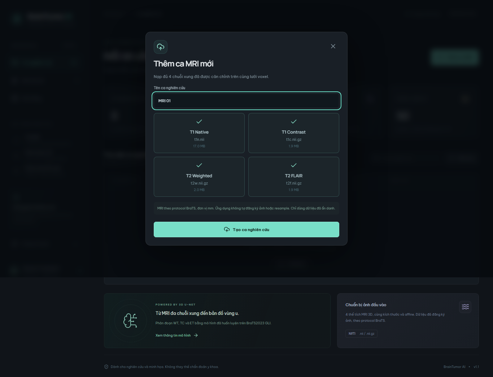
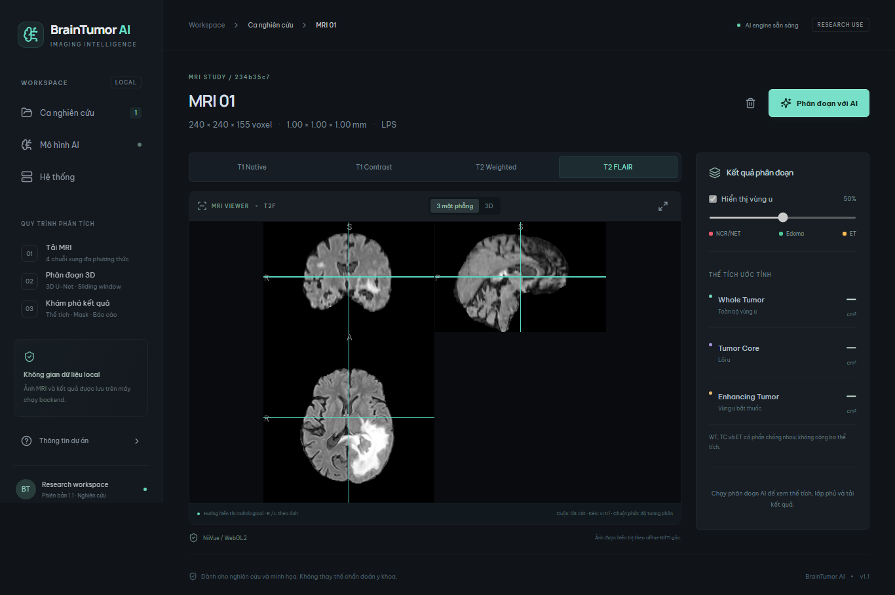
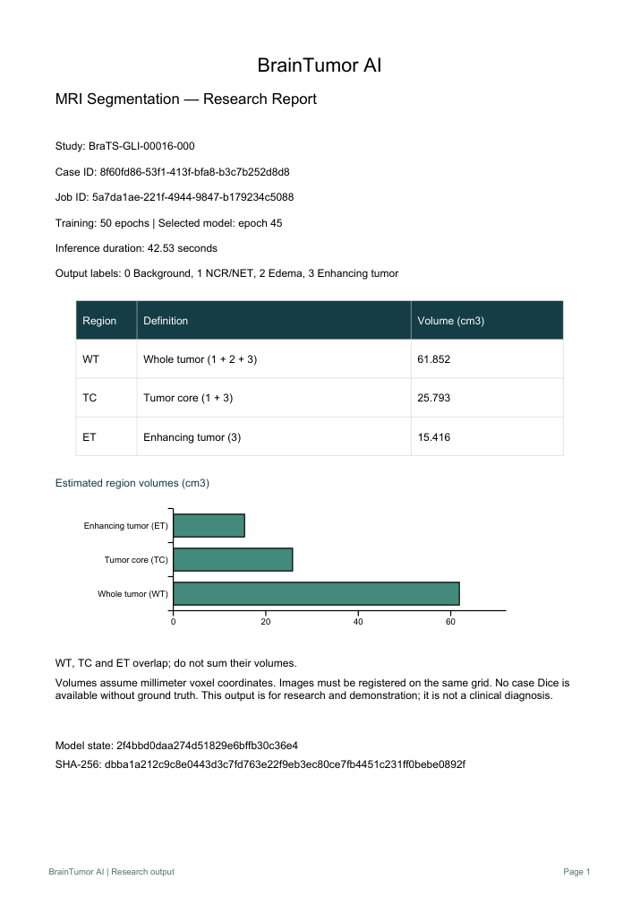

# Rà soát toàn dự án — 13/11/2026

Ứng dụng hoạt động qua các luồng đã kiểm tra trong phạm vi **nghiên cứu local trên CPU với MRI đã tiền xử lý theo BraTS**. Chưa có bằng chứng để gọi đây là hệ thống bệnh viện hoặc nền tảng nhiều người dùng đã sẵn sàng triển khai. Kiểm thử không chứng minh phần mềm hết mọi lỗi hoặc mô hình chính xác trên mọi loại MRI.

## Phạm vi rà soát

Đã đọc mã backend, frontend, launcher, script, Docker/Compose, cấu hình kiểm thử và tài liệu chính; đối chiếu preprocessing/inference với notebook, metadata và checkpoint đi kèm. Đã kiểm tra cú pháp 27 code cell của notebook mà không thực thi train và không sửa notebook. Các dependency bên trong `node_modules`, môi trường Python và binary checkpoint được kiểm tra bằng công cụ/hành vi liên quan, không coi là mã nguồn đã đọc thủ công toàn bộ.

## Sai sót đã sửa

| Vấn đề | Sửa và bằng chứng |
|---|---|
| `--prepare-only` có thể thoát khi gặp server đang chạy, hoặc bị cổng bận chặn trước khi build | Tách bước chuẩn bị khỏi việc kiểm tra server/cổng; khóa riêng cho frontend build. Thêm regression test; chạy chuẩn bị/build thực tế thành công. |
| Kiểm hash checkpoint và protocol nhưng chưa đối chiếu kiến trúc thực được dựng từ metadata ngoài với kiến trúc trong protocol | Đối chiếu toàn bộ cấu hình kiến trúc và bảng nhãn trước khi dựng model. Từ chối metadata đổi stride hoặc đổi ý nghĩa nhãn; xóa metadata cũ khi nạp model thất bại. Hai regression test đạt; checkpoint thật vẫn nạp và phân đoạn được. |
| Chạy pytest từ gốc dự án không import được `app` | Thêm `pytest.ini` với `pythonpath=backend` và testpaths; xác nhận thu thập đủ 34 test từ gốc. Script PowerShell vẫn hỗ trợ thư mục tạm riêng trên Windows. |
| README, hướng dẫn vận hành và VS Code task còn hướng dẫn các nút demo đã bỏ | Đồng bộ luồng tự tải MRI, ba ca khác nhau, đường dẫn khởi động và trạng thái release cũ. Tài liệu bàn giao ban đầu được đánh dấu là lịch sử. |

Backend vẫn giữ API import bundle cũ để tương thích; giao diện không gọi tự động. Khi import bằng API này, tên ca dùng tên nguồn thay cho tự thêm tiền tố demo. Các ca/kết quả người dùng đã có không bị đổi hoặc xóa.

## Kết quả kiểm chứng

| Kiểm tra | Kết quả |
|---|---|
| Backend `scripts/test.ps1` | **34 passed**, 3 cảnh báo deprecation từ dependencies |
| Frontend Vitest | **14 passed** |
| Playwright / Edge headless | **2 passed**; upload `.nii` và `.nii.gz`, mở MRI, chuyển đủ bốn chuỗi xung, 3D/ba mặt phẳng, trạng thái hệ thống và dialog trên mobile |
| TypeScript + Vite | Build thành công; fingerprint của dist khớp source hiện tại |
| Prettier | Đạt |
| `npm audit --json` | **0 vulnerabilities** ở thời điểm rà soát, gồm cả dependency phát triển; [kết quả](qa/npm-audit.json) |
| `python -m pip check` | Không có xung đột phụ thuộc trong môi trường đang dùng; đây không phải quét lỗ hổng Python |
| Python, PowerShell, JSON, Compose YAML | Kiểm tra cú pháp/cấu trúc đạt; không thay cho kiểm thử container |
| Launcher thật | Khởi động UI/API/model status tại cổng 8091 bằng database/storage tạm riêng, rồi dừng sạch; cổng được giải phóng |
| Checkpoint | SHA-256 khớp metadata và giữ nguyên `dbba1a212c9c8e0443d3c7fd763e22f9eb3ec80ce7fb4451c231ff0bebe0892f` |
| Split đã lưu | Train/validation/test không giao nhau về case ID hoặc mã subject BraTS; chỉ kiểm metadata, không tái dựng lịch sử train |

Backend tests bao phủ upload sai định dạng/hình học, giới hạn kích thước, tín hiệu lỗi, đơn vị, cleanup, hàng đợi, chống gửi lặp, chặn xóa khi đang chạy, lỗi worker, retry, restart, lịch sử, artifact, ZIP, static routes, khóa storage và hợp đồng model. Phần kiểm thử API dùng model giả được đánh dấu; không dùng những test này để báo cáo chất lượng AI.





## Một ca khác chạy AI thật

Dùng `BraTS-GLI-00016-000` từ `data/mri_cases`, là ca khác với `00312` trong bundle cũ và nằm trong danh sách test đã lưu. Script [`verify_case.py`](../scripts/verify_case.py) chạy trong kho tạm riêng, không thêm kết quả vào thư viện người dùng.

- Đầu vào 240 × 240 × 155, voxel 1 mm; CPU, checkpoint thật.
- Suy luận **42,53 giây** trong lần kiểm tra này; không phải cam kết tốc độ cho các máy khác.
- Mask `uint8`, có nhãn 0/1/2/3 và giữ shape/affine của đầu vào.
- Thể tích tính lại trực tiếp từ mask khớp JSON: WT **61,852 cm³**, TC **25,793 cm³**, ET **15,416 cm³**.
- PDF, JSON và ZIP tải qua API; ba file trong ZIP trùng byte với các artifact riêng.
- Job và PDF vẫn truy cập được sau một lần khởi động lại API kiểm tra.
- PDF có một trang, tên ca và các số liệu đúng; đã render để kiểm tra bố cục.

[Kết quả kiểm chứng JSON](qa/real-case-00016/verification.json) · [PDF xuất từ lần chạy thật](qa/real-case-00016/report.pdf)



Lần chạy này kiểm tra vận hành và tính nhất quán đầu ra, **không tính Dice với ground truth**. Các metric hiển thị trong model card vẫn là số liệu đã ghi nhận của lần train V2, không phải đánh giá mới hoặc độ chính xác riêng của ca này.

## Các phần còn thiếu hoặc chưa xác nhận

1. **PostgreSQL/Docker và CUDA chưa chạy thử trong môi trường hiện tại.** Máy chưa có Docker; đã kiểm cấu trúc/cú pháp nhưng chưa xác nhận build container, persistence PostgreSQL hoặc GPU inference.
2. **Chưa có xác thực, phân quyền hay nền tảng nhiều người dùng.** Cấu hình phục vụ local/loopback; không tự coi cấu hình này là bản triển khai Internet. Chưa có audit trail người dùng, migrations Alembic, quy trình backup/restore đã diễn tập hoặc queue phân tán.
3. **Đầu vào bệnh viện thô chưa được hỗ trợ đầy đủ.** Cần đủ bốn chuỗi xung đã căn chỉnh/tiền xử lý theo BraTS. Chưa có DICOM/PACS, registration, skull stripping hoặc resampling trong ứng dụng. Kiểm tra shape/affine không thể tự xác nhận người dùng chọn đúng loại chuỗi xung hay đúng bệnh nhân.
4. **Chưa xác nhận chất lượng ngoài tập BraTS.** Chưa đánh giá lại toàn bộ test set trong phiên rà soát và chưa có xác nhận lâm sàng. Ba ca đặt sẵn giúp trình bày nhiều đầu vào, không chứng minh khả năng tổng quát trên MRI bệnh viện.
5. **Tái lập môi trường backend còn cần chặt hơn khi bàn giao triển khai.** Frontend có lockfile; backend hiện dùng khoảng phiên bản. Nên chốt bộ phiên bản đã thử riêng cho CPU/CUDA, kiểm thử PostgreSQL thật, và chạy CI trên kho mã trước khi phát hành để vận hành lâu dài. Các cảnh báo deprecation hiện chưa làm test thất bại nhưng cần theo dõi khi nâng dependency.
6. **Bản ZIP 1.1.0 cũ không tự cập nhật.** Đó là snapshot trước khi bỏ UI demo. Thao tác hiện tại nên dùng mã trong workspace; muốn bàn giao thì tạo ZIP tên mới theo hướng dẫn vận hành. Ba ca trong `data/mri_cases` được giữ cục bộ, không tự đưa vào release.

## Chạy lại kiểm tra

Tại gốc dự án:

```powershell
powershell -ExecutionPolicy Bypass -File scripts/test.ps1
python scripts/verify_case.py --case-dir data/mri_cases/BraTS-GLI-00016-000
python scripts/launch.py --prepare-only
```

Trong `frontend`:

```powershell
npm test
npm run format:check
npm run build
npm run test:e2e
npm audit
```

Sau khi sửa backend, đóng cửa sổ đang chạy rồi mở lại `START_BRAINTUMOR.cmd` để nạp mã mới. Notebook, dữ liệu BraTS nguồn và trọng số huấn luyện không bị sửa trong lần rà soát này.
